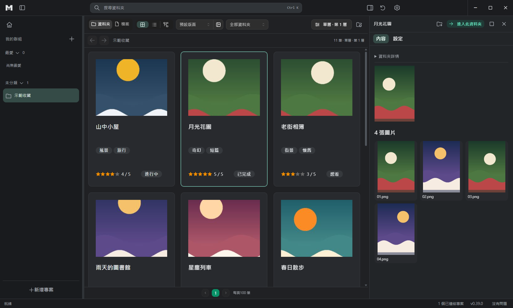
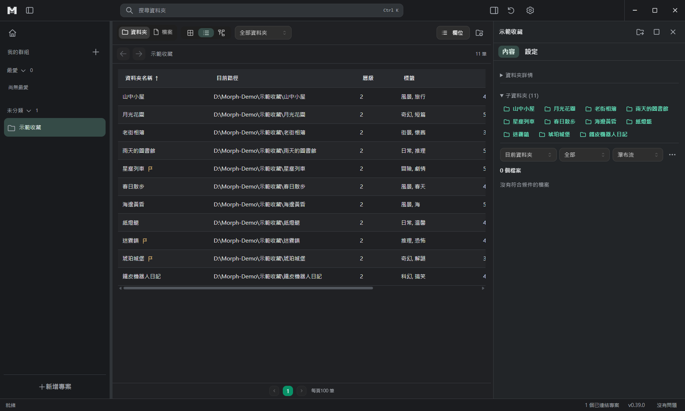
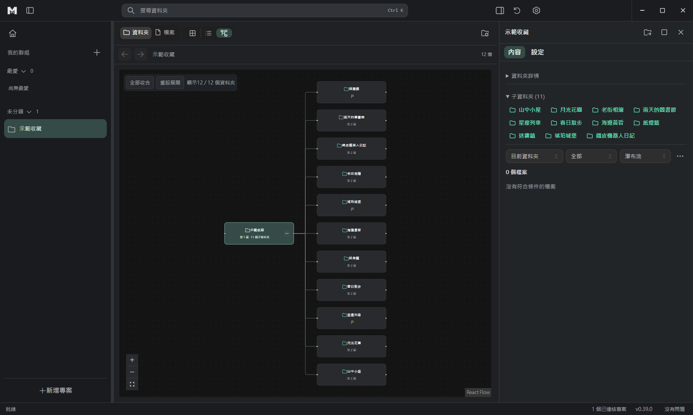
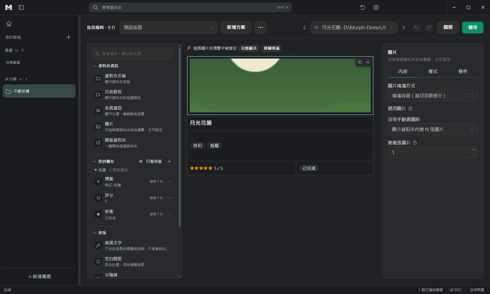
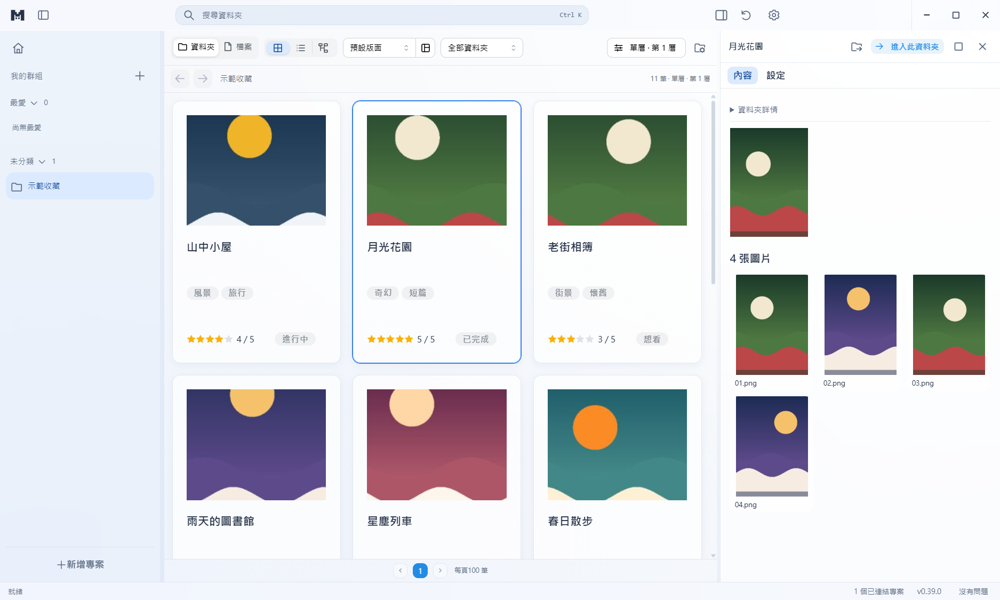
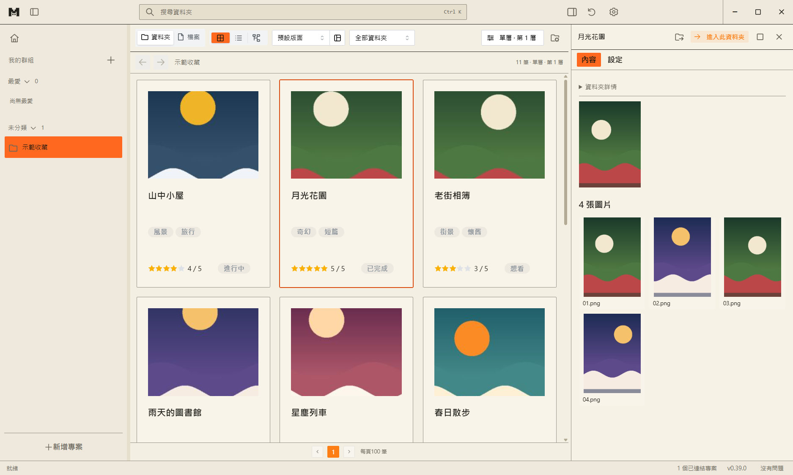
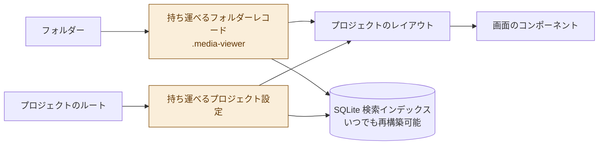

<h1 align="center">
  <picture>
    <source media="(prefers-color-scheme: dark)" srcset="docs/brand/morph-mark-dark.svg">
    
  </picture>
  <br>
  M:orph
</h1>

<p align="center"><strong>Media Browser</strong><br><em>同じコレクションを、別のかたちで。</em></p>

<p align="center">
  <a href="README.md">English</a> · <a href="README.zh-TW.md">繁體中文</a> · 日本語
</p>

M:orph は、Windows を主な対象とした**ローカルのメディアコレクションブラウザー**です。

マンガ、アルバム、動画、音楽、ゲームをフォルダーで整理している方に、より直感的な閲覧と管理の方法を提供します。

コレクションのあるフォルダーを選ぶだけでプロジェクトを作成でき、フォルダーにカバー、タグ、評価などの情報を追加して、その見せ方を自由に決められます。

一般的なファイルマネージャーと違い、M:orph は**コレクションの中身と表示方法を分けて管理**します。元のファイル構成を整理し直さなくても、自分に合った閲覧画面を作れます。

## 主な特長

**三つの閲覧モード**

同じコレクションを、カード・表・ツリーの表示に自由に切り替えられます。フィルターや表示設定はプロジェクトごとに保持されます。

<table>
  <tr>
    <td align="center"><br>カード</td>
    <td align="center"><br>表</td>
    <td align="center"><br>ツリー</td>
  </tr>
</table>

**カードのレイアウトを自由に設計**

ドラッグ＆ドロップのエディターで、カバー、名前、タグ、評価などのフィールドを自由に配置できます。コンポーネントのサイズ、位置、スタイルを調整して、自分だけの閲覧画面を作れます。

**コレクション情報はフォルダーと一緒に**

追加した作品情報は、フォルダーと一緒に移動できる保存データとして、フォルダー内に保存されます。コレクションを別の場所や別のパソコンに移しても、このデータを残しておけば、再リンク時に情報を読み込めます。

**さまざまなメディアを一か所で**

コレクションの管理だけでなく、M:orph の中でマンガを読んだり、画像を見たり、音声・動画を再生したり、文書を表示したりできます。コレクション内のゲームを M:orph から起動することもできます。

**元のファイル構成はそのまま**

M:orph は、閲覧のために元のメディアを移動・名前変更・削除することはありません。追加した情報を保存するための隠しレコードだけを、管理対象のフォルダーに作成します。

## 機能紹介

### 1. コレクションの閲覧と検索

M:orph はコレクションを「プロジェクト」で管理し、各プロジェクトは指定した一つのルートフォルダーに対応します。

フォルダーの階層に沿って閲覧でき、コレクションをさまざまな方法で表示できます。

- **カード表示：** カバー、タグ、独自の情報を中心にした視覚的な閲覧。
- **表表示：** 多数の作品の名前、評価、日付などのフィールドを比べるのに向いています。
- **ツリー表示：** フォルダー間の階層を保ち、複雑なディレクトリ構成を見やすくします。

フォルダーを選択すると、右側のパネルに関連情報と内容のプレビューが表示されるので、現在のコレクション一覧を離れる必要はありません。

内蔵の検索は、通常のキーワード、フィールド条件、AND／OR／除外、数値と日付の比較に対応します。よく使う検索条件は保存して再利用できます。

### 2. カードのレイアウトを設計する

M:orph の中心的な考え方の一つは、コレクションをどう表示するかを利用者が決められることです。

<p align="center">
  
</p>

ビジュアルエディターで、さまざまなコンポーネントをカードに配置できます。

- 名前、パス、テキスト、リンク
- 画像とカバー
- タグ、評価、数値、日付
- 選択肢、区切り線、専用機能のコンポーネント

各コンポーネントは、位置、サイズ、文字のスタイル、色、枠線などを調整できます。

**代替フィールド**

一つのコンポーネントに複数のデータソースを指定できます。たとえば、Steam の作品名を優先し、それがなければ DLsite の作品名を使い、どちらもなければ自分で入力した名前を表示する、といった指定ができます。

**複数のレイアウト**

一つのプロジェクトに複数のレイアウトを保存し、コンテンツの種類ごとに使うデザインを指定できます。

編集中は、実際のコレクションのデータでプレビューして、実際に使うときの見え方を確認できます。

### 3. メディアの閲覧と再生

M:orph は作品の情報を表示するだけでなく、対応するメディアを直接閲覧・再生することもできます。

**画像とマンガ**

アルバムのメイソンリー表示、全画面の画像ビューアー、見開き表示と右から左への読み進めに対応したマンガビューアーを備えています。

**動画と音楽**

内蔵プレーヤーは、動画の続きからの再生、SRT／VTT 字幕、プロジェクトをまたぐ再生キューに対応します。動画を正しくデコードできないときは、システムのプレーヤーで開けます。

**文書と圧縮ファイル**

PDF、ZIP、CBZ をアプリ内で表示できます。

### 4. ゲームコレクションの管理

M:orph は、一部のゲームフォルダーを認識できます。日本のさまざまなビジュアルノベルエンジンで制作されたゲームにも対応しています。

ゲームごとに、EXE の実行、起動引数の指定、ファイル・フォルダー・URL・ショートカットを開くといった起動アクションを設定できます。

Locale Emulator で作ったショートカットも使え、元の起動設定が保たれます。

ゲームの動作に影響しないよう、M:orph はゲームのルートフォルダーの内部を保護領域として扱い、通常の閲覧でその中にレコードを作ることはありません。

### 5. ウェブサイトから作品情報を補う

作品情報をすべて手入力したくないときは、対応サイトの作品ページのアドレスを貼り付けるだけで済みます。

M:orph は取得元を判別し、取得できる情報をプレビューとして表示します。取り込むフィールドは自分で選べます。

現在の対応サイト：E-Hentai／ExHentai、Steam、DLsite、VNDB、Bangumi、AniList、Hitomi、Pixiv、MusicBrainz、Open Library、Wikimedia Commons。

外部のデータをバックグラウンドで自動取得することはなく、ユーザーがプレビューを要求したときだけ接続します。一部の取得元にはアダルトコンテンツが含まれます。利用の際は各サイトの利用規約に従ってください。

### 6. 外観と言語

M:orph には三つの表示テーマがあります。

- ダーク
- すりガラス
- ペーパー＆オレンジ

<table>
  <tr>
    <td align="center"><br>ダーク</td>
    <td align="center"><br>すりガラス</td>
    <td align="center"><br>ペーパー＆オレンジ</td>
  </tr>
</table>

対応言語：繁体字中国語、簡体字中国語、英語、日本語、スペイン語。

## ダウンロードとインストール

**現在の状況：アルファ開発段階で、まだ公開リリースはありません。**

最初の公開バージョンが出たら、[GitHub Releases](https://github.com/ZekeGan/Morph_media-browser/releases) で配布します。

Windows 向けに二種類の実行版を予定しています。

| 版 | 説明 |
| --- | --- |
| インストーラー版 | Windows のインストーラーでインストールします |
| ポータブル版 | インストール不要で、そのまま実行できます |

現在の開発版にはコード署名がないため、Windows で SmartScreen の警告が表示されることがあります。実行する前に、ファイルの入手元が信頼できることを確認してください。

開発者は、下記のコマンドで起動やビルドができます。

詳しい操作方法は[使い方ガイド](docs/USER_GUIDE.md)（英語）を参照してください。画面のデータはすべて自作のサンプルです。

## データの保存方法

M:orph は**ローカル優先で、データを持ち運べる**設計です。

コレクションの情報、プロジェクトのレイアウト、検索インデックスを分けて保存します。



オレンジ色の二つの記録が元データで、検索インデックスはそのコピーです。

**コレクションのデータ**

管理対象のフォルダーには、隠しの `.media-viewer` レコードが作られ、フィールド情報と関連アセットを保存します。

このディレクトリ名は、製品名を変更する前のデータ形式をそのまま使っているもので、別のアプリではありません。

**プロジェクト設定**

プロジェクトは、コレクションの範囲、フィールド設定、表示レイアウトを管理します。同じコレクションのデータを、プロジェクトごとに違う画面で表示できます。

**ローカル検索インデックス**

M:orph は、フォルダーと一緒に移動できる保存データをもとに、SQLite でローカルの検索インデックスを作ります。インデックスは必要なときに再構築できます。

アプリの設定とローカルのインデックスは、ユーザーの `%APPDATA%\media-viewer` に保存されます。

M:orph は閲覧のために元のメディアファイルを変更しません。アプリが作ったレコードを整理したいときは、先に対象範囲のプレビューが表示されます。

## 開発と技術

必要な環境：**Node.js 24 と pnpm 10**

開発環境を起動します。

```bash
pnpm install
pnpm dev
```

よく使うコマンド：

| コマンド | 用途 |
| --- | --- |
| `pnpm dev` | 開発モード |
| `pnpm build` | 型チェックとビルド |
| `pnpm typecheck` | 型チェック |
| `pnpm test` | データとロジックのテスト |
| `pnpm test:ui:changed` | 変更分の UI テスト |
| `pnpm test:ui:smoke` | 中核の UI テスト |
| `pnpm format:check` | 書式チェック |
| `pnpm dist` | Windows の実行ファイルをビルド |

主な技術：Electron、React 19、Vite 7、TypeScript、Mantine 8、Node SQLite、Playwright。

アーキテクチャ全体、モジュールの責任、検証方法は、[アーキテクチャ文書](docs/ARCHITECTURE.md)と[実装と検証](docs/IMPLEMENTATION.md)を参照してください。

## 開発状況

現在のバージョン：**0.39.0 Alpha**

M:orph は作者が主導する個人のオープンソースプロジェクトで、現在も開発を続けています。機能、画面、データ形式は開発の進行に合わせて変わることがあります。

**Human-led, AI-built**

プロジェクトの方向性、要件、設計上の判断、動作確認と最終承認は人間が担当し、コードは主に作者の指示とレビューのもとで、OpenAI Codex や Anthropic の Claude Code などの AI 開発エージェントが書いています。

更新内容は [CHANGELOG](CHANGELOG.md) を参照してください。

## ドキュメント

- [使い方ガイド](docs/USER_GUIDE.md)（英語）
- [ドキュメント索引](docs/README.md)
- [製品の範囲](docs/PRODUCT.md)
- [アーキテクチャ](docs/ARCHITECTURE.md)
- [現在の作業と既知の制限](docs/WORK_ITEMS.md)
- [コントリビューションガイド](CONTRIBUTING.md)
- [セキュリティポリシー](SECURITY.md)

開発に参加する前に、[CLAUDE.md](CLAUDE.md) または [AGENTS.md](AGENTS.md) を読んでください。設計ドキュメントは主に繁体字中国語で書かれています。

## ライセンス

Copyright (C) 2024–2026 Zeke Gan.

M:orph のソースコードは **GNU General Public License v3.0 only（GPL-3.0-only）** に基づいて提供されます。

GPL の条件に従って、コードを使用・研究・変更・配布できます。変更版を配布するときは、ソースコードの提供やライセンス表示の保持などの規定に従う必要があります。

ライセンス全文は [LICENSE](LICENSE) と [NOTICE.md](NOTICE.md) を参照してください。

**名称とロゴには別の使用制限があります。**

M:orph の名称とブランドロゴは、上記のコードのライセンスの対象に含まれません。変更版を公開するときは、自分の名称とロゴを使い、公式版との違いを明確に示してください。

M:orph をもとに開発したことを示すのは構いませんが、変更版を公式版であるかのように見せたり、原作者の承認を受けているかのように示したりしてはいけません。

GPL は、その条件に従った有償での配布を認めています。公式ビルドは、このリポジトリの Releases ページで公開されているファイルです。

詳しいルールは[名称とロゴのポリシー](TRADEMARK.md)を参照してください。

M:orph は、データの取得元となるサードパーティのウェブサイトとは、提携関係も協力関係もありません。

## 作者

**Zeke Gan**

[GitHub](https://github.com/ZekeGan)
