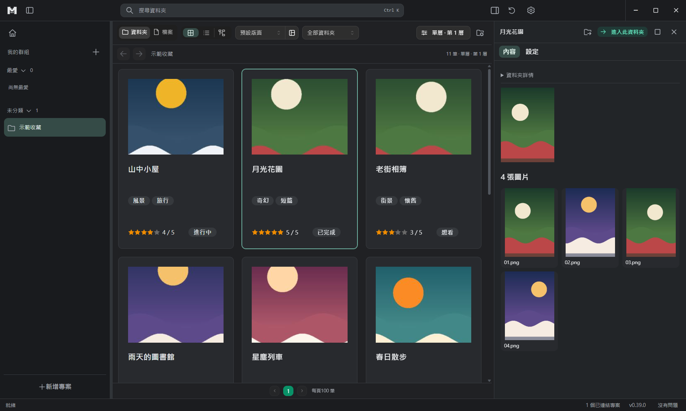
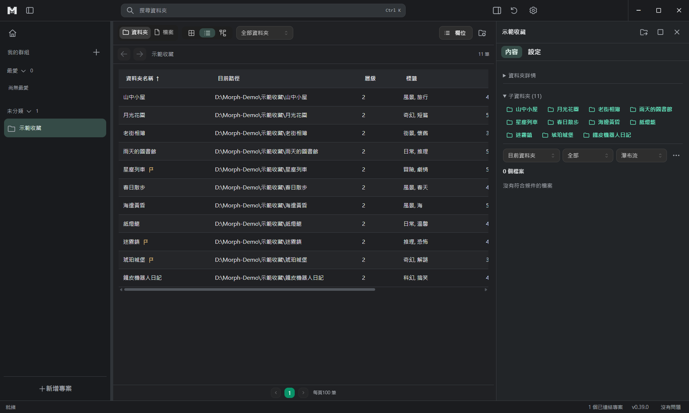
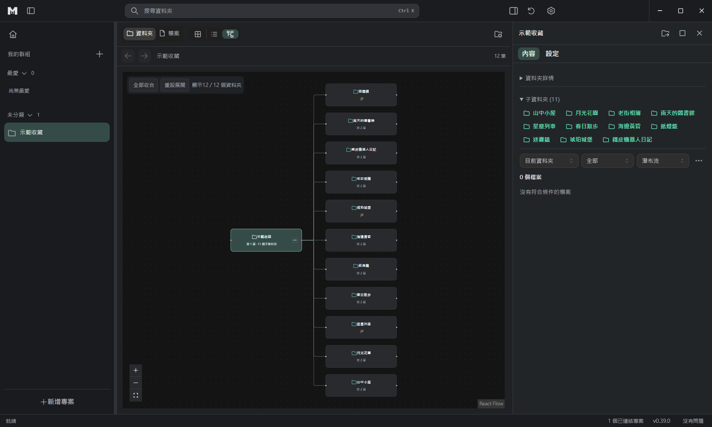
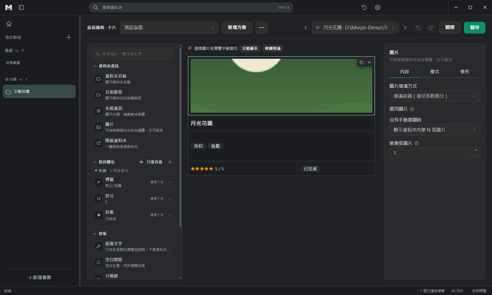
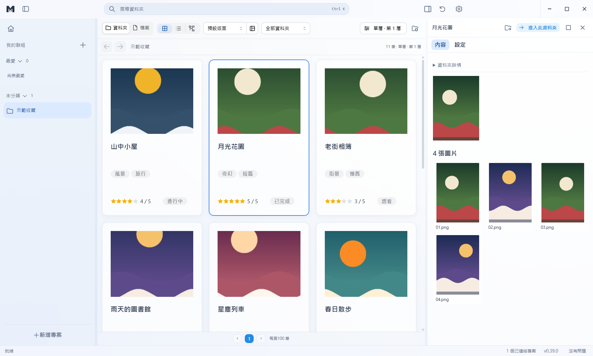
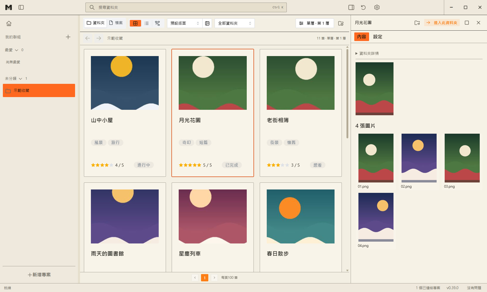
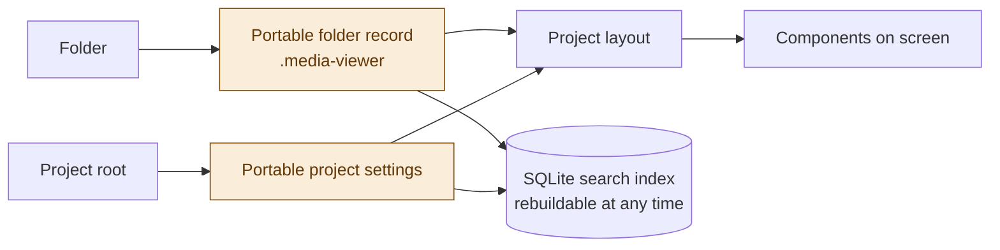

<h1 align="center">
  <picture>
    <source media="(prefers-color-scheme: dark)" srcset="docs/brand/morph-mark-dark.svg">
    
  </picture>
  <br>
  M:orph
</h1>

<p align="center"><strong>Media Browser</strong><br><em>The same collection, shown a different way.</em></p>

<p align="center">
  English · <a href="README.zh-TW.md">繁體中文</a> · <a href="README.ja.md">日本語</a>
</p>

M:orph is a **local media collection browser**, built mainly for Windows.

If you keep manga, albums, videos, music or games in folders, M:orph gives you a more intuitive way to browse and manage them.

Choose the folder your collection lives in to create a project, add covers, tags, ratings and other information to your folders, and decide freely how they are shown.

Unlike a file manager, M:orph keeps **collection information separate from display settings**. You do not have to reorganise your existing files to get a browsing interface that suits you.

## Highlights

**Three browsing modes**

Switch the same collection between card, table and tree views. Every project remembers its own filters and view settings.

<table>
  <tr>
    <td align="center"><br>Card</td>
    <td align="center"><br>Table</td>
    <td align="center"><br>Tree</td>
  </tr>
</table>

**Custom card layouts**

With a drag-and-drop editor you arrange covers, names, tags, ratings and other fields as you like. Adjust the size, position and style of each component to build a browsing interface of your own.

**Information travels with the folder**

The information you add about an item is stored in a portable record inside its folder. If you move your collection to another location or computer, keep these records so M:orph can restore the information when you relink the collection.

**Many kinds of media in one place**

Besides managing your collection, you can read manga, view images, play audio and video, and view documents inside M:orph. You can also launch games from your collection through M:orph.

**Your original file structure stays as it is**

M:orph never moves, renames or deletes your original media just for browsing. It only creates the hidden records it needs in managed folders, to keep the information you add.

## Features

### 1. Browsing and search

M:orph manages a collection as a "project", and each project points at one root folder you choose.

You can browse by folder level and show the collection in different ways:

- **Card mode:** visual browsing built around covers, tags and your own information.
- **Table mode:** good for comparing the names, ratings, dates and other fields of many items.
- **Tree mode:** keeps the hierarchy between folders, which helps with complex directory structures.

When you select a folder, the right-hand panel shows its information and a preview of its contents, so you do not have to leave the collection list.

Built-in search supports plain keywords, field conditions, AND / OR / exclude operators, and numeric and date comparisons. Frequently used searches can be saved for next time.

### 2. Custom card layouts

One of the core ideas of M:orph is that you decide how your collection should be displayed.

<p align="center">
  
</p>

With the visual editor you place components on a card:

- Names, paths, text and links
- Images and covers
- Tags, ratings, numbers and dates
- Choices, dividers and special-purpose components

Each component can be adjusted in position, size, text style, colour, border and more.

**Fallback fields**

One component can point at several data sources. For example, it can display the title from Steam, fall back to the title from DLsite if the Steam title is missing, and use your manually entered title if neither is available.

**Several layouts**

A project can keep several layouts and use a different design for each content type.

While editing, you can preview with real data from your collection to check how the layout will look in actual use.

### 3. Reading and playback

M:orph does more than show information about your collection; it also lets you view or play supported media directly.

**Images and manga**

An album masonry view, a full-screen image viewer, and a manga reader with spreads and right-to-left reading.

**Video and music**

A built-in player supports resuming videos, SRT / VTT subtitles and a cross-project play queue. When a video cannot be decoded properly, you can open it with the system player.

**Documents and archives**

PDF, ZIP and CBZ files can be viewed inside the app.

### 4. Game collection management

M:orph recognises some game folders, including those of games built with many Japanese visual-novel engines.

You can set up launch actions for each game, such as running an EXE, passing launch arguments, or opening a file, folder, URL or shortcut.

Shortcuts made with Locale Emulator also work and keep their own launch settings.

To avoid disturbing the game, M:orph treats the inside of a game's root folder as a protected area and never creates records there during ordinary browsing.

### 5. Fill in work information from websites

If you do not want to type everything in by hand, paste the URL of an item's page on a supported website.

M:orph recognises the source, fetches the information available and shows a preview, and you choose which fields to import.

Currently supported: E-Hentai / ExHentai, Steam, DLsite, VNDB, Bangumi, AniList, Hitomi, Pixiv, MusicBrainz, Open Library and Wikimedia Commons.

External data is never fetched in the background; M:orph only connects when you ask for a preview. Some sources contain adult content, so please follow each site's terms of service.

### 6. Appearance and language

M:orph offers three interface themes:

- Dark
- Frosted glass
- Warm paper

<table>
  <tr>
    <td align="center"><br>Dark</td>
    <td align="center"><br>Frosted glass</td>
    <td align="center"><br>Warm paper</td>
  </tr>
</table>

Supported languages: Traditional Chinese, Simplified Chinese, English, Japanese and Spanish.

## Download and install

**Current status: alpha development; no public release yet.**

Once the first public version is out, it will be available from [GitHub Releases](https://github.com/ZekeGan/Morph_media-browser/releases).

Two Windows builds are planned:

| Build | Description |
| --- | --- |
| Installer | Installed with the Windows installer |
| Portable | Runs directly, no installation needed |

The current development builds are not code-signed, so Windows may show a SmartScreen warning. Make sure you trust where the file came from before running it.

Developers can start or build the app with the commands below.

For detailed instructions see the [user guide](docs/USER_GUIDE.md). All data shown in the screenshots is generated sample data.

## How your data is stored

M:orph is **local-first, with portable data**.

It keeps collection information, project layouts and the search index separately.



The two orange records are the source of truth; the search index is only a copy.

**Collection data**

Every managed folder gets a hidden `.media-viewer` record that stores its field information and related assets.

This directory name comes from the data format used before the product was renamed; it is not another application.

**Project settings**

A project manages the scope of the collection, its field settings and its display layout. Different projects can use the same collection data and show it through different interfaces.

**Local search index**

M:orph builds a local search index with SQLite from the portable records. The index can be rebuilt when needed.

Application settings and the local index are kept in the user's `%APPDATA%\media-viewer`.

M:orph does not modify your original media files for browsing. When you want to clean up the records the app created, it first shows a preview of the scope.

## Development and technology

Requirements: **Node.js 24 and pnpm 10**

Start the development environment:

```bash
pnpm install
pnpm dev
```

Common commands:

| Command | Purpose |
| --- | --- |
| `pnpm dev` | Development mode |
| `pnpm build` | Type-check and build |
| `pnpm typecheck` | Type-check |
| `pnpm test` | Data and logic tests |
| `pnpm test:ui:changed` | UI tests for the changed files |
| `pnpm test:ui:smoke` | Core UI tests |
| `pnpm format:check` | Format check |
| `pnpm dist` | Build the Windows executables |

Main technologies: Electron, React 19, Vite 7, TypeScript, Mantine 8, Node SQLite and Playwright.

For the full architecture, module responsibilities and how changes are verified, see the [architecture document](docs/ARCHITECTURE.md) and [implementation and verification](docs/IMPLEMENTATION.md).

## Project status

Current version: **0.39.0 Alpha**

M:orph is a personal open-source project led by its author and is still under active development. Features, the interface and the data format may change as it progresses.

**Human-led, AI-built**

A human is responsible for the project's direction, requirements, design decisions and acceptance; the code is written mainly by AI coding agents such as OpenAI Codex and Anthropic's Claude Code, under the author's direction and review.

See the [CHANGELOG](CHANGELOG.md) for updates.

## Documentation

- [User guide](docs/USER_GUIDE.md)
- [Documentation index](docs/README.md)
- [Product scope](docs/PRODUCT.md)
- [Architecture](docs/ARCHITECTURE.md)
- [Current work and known limits](docs/WORK_ITEMS.md)
- [Contributing](CONTRIBUTING.md)
- [Security policy](SECURITY.md)

Before contributing, please read [CLAUDE.md](CLAUDE.md) or [AGENTS.md](AGENTS.md). The design documents are written mainly in Traditional Chinese.

## Licence

Copyright (C) 2024–2026 Zeke Gan.

The source code of M:orph is licensed under the **GNU General Public License v3.0 only (GPL-3.0-only)**.

You may use, study, modify and distribute the code under the terms of the GPL. When you distribute a modified version, you must follow its requirements, such as providing the source code and keeping the licence notices.

For the full licence see [LICENSE](LICENSE) and [NOTICE.md](NOTICE.md).

**The name and logo have separate usage restrictions.**

The M:orph name and brand logo are not covered by the code licence above. When you publish a modified version, please use your own name and logo and make clear how it differs from the official version.

You may say that your work is based on M:orph, but you may not pass a modified version off as the official one or suggest that the original author endorses it.

The GPL allows paid distribution that follows its terms. The official builds are the files published on this repository's Releases page.

For the detailed rules see the [name and logo policy](TRADEMARK.md).

M:orph is not affiliated with, or partnered with, the third-party websites it can read data from.

## Author

**Zeke Gan**

[GitHub](https://github.com/ZekeGan)
