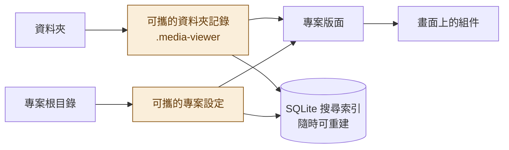

<h1 align="center">
  <picture>
    <source media="(prefers-color-scheme: dark)" srcset="docs/brand/morph-mark-dark.svg">
    
  </picture>
  <br>
  M:orph
</h1>

<p align="center"><strong>Media Browser</strong><br><em>同一份收藏，換個方式呈現。</em></p>

<p align="center">
  <a href="README.md">English</a> · 繁體中文 · <a href="README.ja.md">日本語</a>
</p>

M:orph 是一款以 Windows 為主要平台的**本機媒體收藏瀏覽器**。

如果你習慣使用資料夾整理漫畫、相簿、影片、音樂或遊戲，M:orph 可以讓你用更直覺的方式瀏覽與管理這些收藏。

只需要選擇收藏所在的資料夾，就能建立專案，替資料夾加入封面、標籤、評分與其他資訊，並自由決定它們的呈現方式。

與一般檔案總管不同，M:orph 將**收藏內容與顯示方式分開管理**。你不需要重新整理原本的檔案結構，也能建立符合自己習慣的瀏覽介面。

## 主要特色

**三種瀏覽模式**

同一份收藏可以自由切換卡片、表格與樹狀檢視。每個專案都能保留自己的篩選條件與檢視設定。

<table>
  <tr>
     <td align="center"><br>卡片</td>
    <td align="center"><br>表格</td>
    <td align="center"><br>樹狀</td>
  </tr>
</table>

**自訂卡片版面**

透過拖放式編輯器，自由安排封面、名稱、標籤、評分及其他欄位。你可以調整組件的大小、位置與樣式，建立專屬的收藏瀏覽介面。

**收藏資訊跟著資料夾走**

新增的作品資訊會保存在資料夾的可攜記錄中。即使將收藏搬移到其他位置或電腦，只要保留相關記錄，就能重新連結並讀取。

**整合多種媒體檢視功能**

除了管理收藏，也能直接在 M:orph 中閱讀漫畫、瀏覽圖片、播放影音、檢視文件，或啟動收藏中的遊戲。

**保留原始檔案結構**

M:orph 不會為了瀏覽而搬移、重新命名或刪除你的原始媒體。程式只會在受管理的資料夾中建立必要的隱藏記錄，用來保存你新增的資訊。

## 功能介紹

### 1. 收藏瀏覽與搜尋

M:orph 以「專案」管理收藏，每個專案對應一個指定的根資料夾。

你可以依照資料夾層級瀏覽內容，也能使用不同方式呈現收藏：

- **卡片模式：** 以封面、標籤與自訂資訊為主的視覺化瀏覽。
- **表格模式：** 適合比較大量收藏的名稱、評分、日期與其他欄位。
- **樹狀模式：** 保留資料夾之間的階層關係，方便瀏覽複雜的目錄結構。

選取資料夾時，右側面板會顯示相關資訊與內容預覽，不必離開目前的收藏清單。

內建搜尋支援一般關鍵字、欄位條件、AND／OR／排除運算，以及數字與日期比較。也可以保存常用搜尋條件，方便之後再次使用。

### 2. 自訂卡片版面

M:orph 的核心功能之一，是讓使用者決定自己的收藏應該如何顯示。

<p align="center">
  
</p>

你可以透過視覺化編輯器，將各種組件放進卡片：

- 名稱、路徑、文字與連結
- 圖片與封面
- 標籤、評分、數字及日期
- 選項、分隔線與專用功能組件

每個組件都能調整位置、尺寸、文字樣式、顏色、邊框等設定。

**備用欄位**

同一個組件可以指定多個資料來源，例如優先顯示 Steam 的作品名稱，沒有資料時改用 DLsite 名稱，最後再使用自行輸入的名稱。

**多套版面**

一個專案可以保存多種版面，並依照不同內容類型指定使用哪一套設計。

編輯過程中也能使用真實收藏資料預覽，確認版面在實際使用時的效果。

### 3. 媒體閱讀與播放

M:orph 不只是顯示作品資訊，也能直接檢視部分收藏內容。

**圖片與漫畫**

提供相簿瀑布流、全螢幕圖片檢視，以及支援跨頁、由右至左閱讀的漫畫閱讀器。

**影片與音樂**

內建影音播放器，支援影片續播、SRT／VTT 字幕與跨專案播放佇列。影片無法正常解碼時，也能使用系統播放器開啟。

**文件與壓縮檔**

支援在應用程式內檢視 PDF、ZIP 與 CBZ。

### 4. 遊戲收藏管理

M:orph 可以辨識部分遊戲資料夾，包括多種日系視覺小說引擎。

你可以為每款遊戲設定專屬的啟動動作，例如執行 EXE、指定啟動參數，或開啟檔案、資料夾、網址與捷徑。

也能使用 Locale Emulator 建立的捷徑，保留原本的啟動設定。

為了避免影響遊戲運作，M:orph 會將遊戲根目錄內部視為保護區域，不會因為一般瀏覽而在遊戲內部建立記錄。

### 5. 從網站補充作品資訊

不想手動輸入所有作品資訊時，可以直接貼上支援網站的作品頁面網址。

M:orph 會辨識資料來源，取得可用資訊並提供預覽，再由你選擇要匯入哪些欄位。

目前支援 E-Hentai／ExHentai、Steam、DLsite、VNDB、Bangumi、AniList、Hitomi、Pixiv、MusicBrainz、Open Library 與 Wikimedia Commons。

外部資料不會在背景自動抓取，只有當你主動要求預覽時才會連線。部分來源包含成人內容，使用時請遵守相關網站的服務條款。

### 6. 外觀與語言

M:orph 提供三種介面主題：

- 深色
- 霧白玻璃
- 暖紙

<table>
  <tr>
    <td align="center"><br>深色</td>
    <td align="center"><br>霧白玻璃</td>
    <td align="center"><br>暖紙</td>
  </tr>
</table>

支援繁體中文、簡體中文、英文、日文及西班牙文。

## 下載與安裝

**目前狀態：Alpha 開發階段，尚未正式公開發布。**

第一個公開版本推出後，會在 [GitHub Releases](https://github.com/ZekeGan/Morph_media-browser/releases) 提供下載。

預計提供兩種 Windows 執行版本：

| 版本 | 說明 |
| --- | --- |
| 安裝版 | 使用 Windows 安裝程式安裝 |
| 免安裝版 | 直接執行，不需要安裝 |

目前的開發版尚未進行程式碼簽章，因此 Windows 可能顯示 SmartScreen 安全警告。執行前請確認檔案來源可信。

開發者可以透過下方指令自行啟動或建置。

詳細操作方式請參考 [繁體中文使用指南](docs/USER_GUIDE.zh-TW.md)。畫面中的資料都是自製的示範資料。

## 資料保存方式

M:orph 採用**本機優先、資料可攜**的設計。

它將收藏資訊、專案版面及搜尋索引分開保存。



橘色的兩份記錄是資料來源，搜尋索引只是副本。

**收藏資料**

每個受管理資料夾都會建立隱藏的 `.media-viewer` 記錄，用來保存欄位資訊與相關資產。

這個目錄名稱沿用產品更名前的資料格式，並非另一款應用程式。

**專案設定**

專案負責管理收藏範圍、欄位設定與顯示版面。不同專案可以使用相同收藏資料，卻呈現不同的介面。

**本機搜尋索引**

M:orph 使用 SQLite 建立本機搜尋索引。索引不是收藏資料的唯一來源，必要時可以重新建立。

應用程式設定及本機索引會保存在使用者的 `%APPDATA%\media-viewer` 中。

M:orph 不會為了瀏覽而修改原始媒體檔案。若需要清理應用程式建立的記錄，會先提供操作範圍預覽。

## 開發與技術

開發環境需求：**Node.js 24、pnpm 10**

啟動開發環境：

```bash
pnpm install
pnpm dev
```

常用指令：

| 指令 | 用途 |
| --- | --- |
| `pnpm dev` | 開發模式 |
| `pnpm build` | 型別檢查與建置 |
| `pnpm typecheck` | 型別檢查 |
| `pnpm test` | 資料與邏輯測試 |
| `pnpm test:ui:changed` | 受影響的 UI 測試 |
| `pnpm test:ui:smoke` | 核心 UI 測試 |
| `pnpm format:check` | 格式檢查 |
| `pnpm dist` | 建置 Windows 執行檔 |


主要技術：Electron、React 19、Vite 7、TypeScript、Mantine 8、Node SQLite 與 Playwright。

完整的架構、模組責任與驗證方式請參閱 [架構文件](docs/ARCHITECTURE.md) 及 [執行與驗證](docs/IMPLEMENTATION.md)。

## 開發狀態

目前版本：**0.39.0 Alpha**

M:orph 是由作者主導的個人開源專案，目前仍持續開發中。功能、介面與資料格式可能隨開發進度調整。

**Human-led, AI-built**

專案方向、功能需求、設計決策與驗收由人類負責；程式碼主要在作者指示與審查下，透過 OpenAI Codex、Anthropic Claude Code 等 AI 開發代理完成。

更新內容請參閱 [CHANGELOG](CHANGELOG.md)。

## 文件

- [使用指南](docs/USER_GUIDE.zh-TW.md)
- [文件索引](docs/README.md)
- [產品範圍](docs/PRODUCT.md)
- [系統架構](docs/ARCHITECTURE.md)
- [目前工作與已知限制](docs/WORK_ITEMS.md)
- [貢獻指南](CONTRIBUTING.md)
- [安全政策](SECURITY.md)

參與開發前請先閱讀 [CLAUDE.md](CLAUDE.md) 或 [AGENTS.md](AGENTS.md)。

## 授權

Copyright (C) 2024–2026 Zeke Gan.

M:orph 的原始碼採用 **GNU General Public License v3.0 only（GPL-3.0-only）** 授權。

你可以依照 GPL 條款使用、研究、修改與散布程式碼。對外散布修改版時，須遵守原始碼提供與授權聲明保留等規定。

完整授權請參閱 [LICENSE](LICENSE) 與 [NOTICE.md](NOTICE.md)。

**名稱與標誌另有使用限制。**

M:orph 的名稱與品牌標誌不包含在上述程式碼授權範圍內。發布修改版本時，請使用自己的名稱與標誌，並明確標示與官方版本的區別。

你可以註明作品基於 M:orph 開發，但不得將修改版冒充官方版本，或暗示獲得原作者認可。

GPL 允許符合授權條款的收費散布。官方建置版本以本儲存庫 Releases 頁面發布的檔案為準。

詳細規則請參閱 [名稱與標誌政策](TRADEMARK.md)。

M:orph 與其支援的第三方資料來源網站沒有隸屬或合作關係。

## 作者

**Zeke Gan**

[GitHub](https://github.com/ZekeGan)
