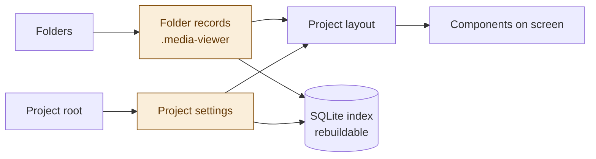
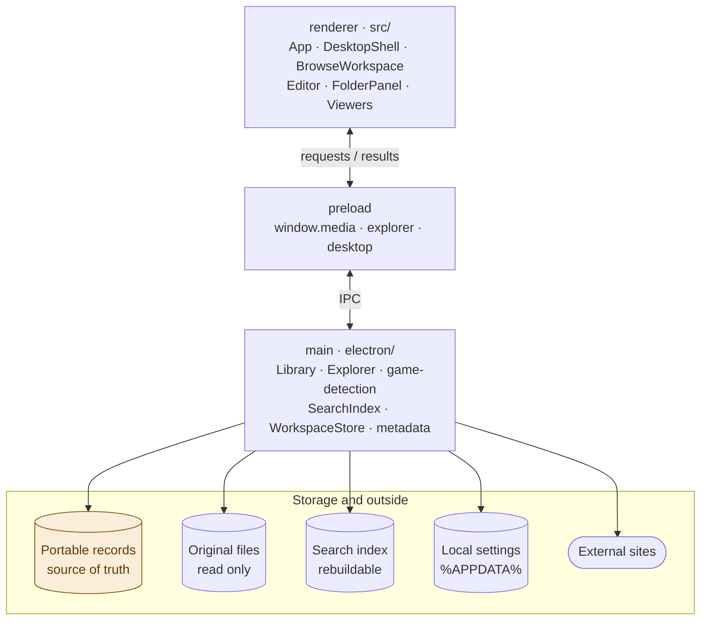

# 現況架構與定位

> 最後確認：2026-11-11。模組責任、資料流與安全邊界；改動模組責任或資料流時同批更新本頁的圖。

依目前程式整理；版本與依賴查 package.json。此頁只持有模組責任，功能規格由 [任務索引](README.md) 導向。舊 Next.js／View／Cell／DataType／JsonStorage 原型不是目標資料模型。

## 名稱與識別字

產品名稱是 **M:orph**（副標題 Media Browser）；套件名稱 `morph`、安裝檔名 `Morph`。為了相容既有資料，下列識別字**沿用舊名稱，不隨產品改名**：資料夾內的隱藏目錄 `.media-viewer`、記錄與設定的 `kind`（`media-viewer.folder`、`media-viewer.project`、`media-viewer.settings`）、使用者資料資料夾 `%APPDATA%\media-viewer`、拖放資料類型 `application/x-media-viewer-*`。這些是資料格式的一部分，更動需要遷移（見 [儲存安全](STORAGE_OPTIONS.md)）。

## 資料流與邊界

資料從資料夾變成畫面的路徑：兩份可攜記錄是資料來源，搜尋索引是可重建的副本。

行程邊界與模組：只有 main 碰檔案系統，每個模組的責任見下方「按問題找入口」。`shared/`（型別與純邏輯）由 renderer 與 main 共同引用。三層之間的引用方向由 `scripts/check-layers.mjs` 在提交前檢查（renderer 與 shared 不引用 main，shared 也不引用 renderer、Node、React）。renderer 的 `src/` 依功能分資料夾，名稱對應 [領域登錄表](areas.json)（`browse/`、`panel/`、`editor/`、`media/`、`video/` 等；共用元件在 `common/`，全域樣式在 `styles/`，主題與語系在 `themes/`、`i18n/`）；功能專屬的 css 與元件放在同一資料夾，`App.tsx`、`main.tsx` 留在 `src/` 根目錄。

`src/main.tsx → PlaybackProvider → App → DesktopShell / BrowseWorkspace → window.media / explorer / desktop → preload → main → Library / Explorer / WorkspaceStore`

Renderer 負責畫面、草稿與互動；preload 只暴露受控 API；main 驗證請求與呼叫來源、執行檔案及系統操作。保留 contextIsolation、sandbox、停用 nodeIntegration；不能讓 renderer 任意讀路徑、執行命令或繞過 main 的身分／邊界檢查。renderer 沒有直接的 IPC，只能呼叫 preload 暴露的固定函式；唯一由畫面帶入的檔案路徑是拖入字幕：preload 用 `webUtils.getPathForFile` 從使用者實際拖入的檔案取得路徑，renderer 只能交出 File，無法指定路徑字串。

側鍵導覽由 main 的 `app-command` 經 `folder:navigate`／`desktop.onFolderNavigation` 傳入工作區；preload 同時接收原生命令與一般 mouseup，取消側鍵 DOM 預設動作，以短時間配對去重，兼容僅送一般事件的驅動。main 換算內容座標及縮放，BrowseWorkspace 再檢查命中區域、可見浮層與忙碌狀態，最後仍經 `visit` 驗證目的地；此通知不授予讀寫路徑權限。訂閱隨工作區卸載清除。

## 按問題找入口

| 範圍 | 主要檔案／符號 | 責任 |
| --- | --- | --- |
| 啟動／IPC／協定／系統操作 | [main](../electron/main.ts)、[preload](../electron/preload.ts) | BrowserWindow、來源驗證、原生對話框、受控媒體串流 |
| IPC 請求檢查與 library 分派 | [ipc-requests](../electron/ipc-requests.ts)、[library-dispatch](../electron/library-dispatch.ts) | 每個 IPC 入口先驗證呼叫來源，再檢查請求形狀（動作在允許清單、各欄位型別）；巢狀內容由寫入端驗證。library 請求在 library-dispatch 轉成 Library、備份與原生對話框呼叫，資料夾選擇以短期代號交給 renderer |
| 專案與可攜記錄 | [library](../electron/library.ts) `Library` | create/link/saveValues、身分、副本與復原；類別只保留協調與狀態，其餘函式在同層模組並由 `Library` 轉呼叫：[掃描與造訪](../electron/library-scan.ts)、[欄位刪除](../electron/library-field-removal.ts)、[專案移除](../electron/library-removal.ts)、[清理與復原](../electron/library-cleanup.ts)、[匯出](../electron/library-export.ts)；移除與欄位刪除共用 [maintenance](../electron/maintenance.ts) 的備份與回滾流程；[backup](../electron/backup.ts) 管理備份資料夾 |
| 原子檔案／路徑 | [files](../electron/files.ts)、[hidden](../electron/hidden.ts) | safePath/within、atomicJson、記錄備份／指紋、Windows 隱藏目錄 |
| 媒體／縮圖／字幕／遊戲動作 | [explorer](../electron/explorer.ts) `Explorer` | attributes、request 分派；其餘函式在同層模組並由 `Explorer` 轉呼叫：[內容列表](../electron/explorer-content.ts)、[串流與縮圖](../electron/explorer-stream.ts)、[外部資料與圖片網址](../electron/explorer-source.ts)、[檔案總覽](../electron/explorer-overview.ts)、[圖片網址](../electron/image-url.ts)、[媒體檔案分類](../electron/media-files.ts)；另有 content/overview/stream/thumbnail、目標綁定與執行、外部資料套用 |
| 遊戲辨識 | [game-detection](../electron/game-detection.ts) | 有限探測、證據與 ROOT 邊界 |
| 搜尋索引 | [search-index](../electron/search-index.ts) `SearchIndex` | Node SQLite、Unicode 子字串 grams、分頁；可重建，非資料來源 |
| 本機 UI 設定 | [workspace](../electron/workspace.ts) `WorkspaceStore` | 群組／排序／窗格／偏好，驗證、保存、尺寸正規化；settings-package／settings-file 處理允許清單、移轉預覽與備份復原 |
| 外部來源 | [metadata](../electron/metadata.ts) | [sources](../shared/sources.ts) 分類註冊、metadata（E-Hentai、Steam）與 metadata-public（共用請求、主機檢查、封面）固定端點；[sources/](../electron/sources/config.ts) 一站一個轉接器加共用來源設定；[metadata-common](../electron/metadata-common.ts) 大小限制與錯誤分類、來源預覽與追溯 |
| 契約與驗證 | [model](../shared/model.ts)、[explorer](../shared/explorer.ts)、[workspace](../shared/workspace.ts) | 型別及寫入前的 runtime 驗證（validateProject、validateDetails 等）；IPC 入口的形狀檢查在 ipc-requests。修改 IPC 時型別、ipc-requests 與呼叫端一起改 |
| 操作通知契約 | [notifications](../shared/notifications.ts)、[Toasts](../src/notices/Toasts.tsx) | main／Explorer 以完成數與問題數建立通知等級；App 接收 notice，例外明確標為 error；Toasts 負責標題、角色及收起時機。專案匯出、清理等操作的顯示文字由 main 組合；均屬瞬時回應，不改可攜 schema |
| 共用純邏輯 | [browse](../shared/browse.ts)、[layouts](../shared/layouts.ts)、[fieldGroups](../shared/fieldGroups.ts)、[images](../shared/images.ts)、[query](../shared/query.ts)、[subtitles](../shared/subtitles.ts)、[reader](../shared/reader.ts)、[gallery](../shared/gallery.ts) | 模式／樹分支、方案、欄位群組、格式、查詢、字幕解析、閱讀分頁及適應尺寸、圖庫尺寸與可見範圍模型 |
| 應用狀態／外框 | [App](../src/App.tsx)、[DesktopShell](../src/shell/DesktopShell.tsx)、[ProjectSettings](../src/settings/ProjectSettings.tsx) | snapshot／草稿／保存、側欄、搜尋入口與視窗控制 |
| 全域外觀／語言／圖示 | [ApplicationSettings](../src/settings/ApplicationSettings.tsx)、[themes](../src/themes/ThemeProvider.tsx)、[i18n](../src/i18n/index.ts)、[icons](../src/common/icons.tsx) | 主題／語言預覽與本機保存、共用 CSS 變數、介面翻譯；不改寫使用者資料 |
| 瀏覽與設定 | [BrowseWorkspace](../src/browse/BrowseWorkspace.tsx)（狀態與導覽）、[BrowseToolbar](../src/browse/BrowseToolbar.tsx)（工具列）、[BrowsePanel](../src/browse/BrowsePanel.tsx)（右側面板）、[BrowseNav](../src/browse/BrowseNav.tsx)（返回／前進與路徑）、[FolderCards](../src/browse/FolderCards.tsx)（卡片格）、`useCardSettings`／`useTableColumns`（CARD 顯示設定保存、TABLE 欄位順序）、[TreeView](../src/browse/TreeView.tsx)、[FolderPanel](../src/panel/FolderPanel.tsx)（資料夾設定；網站匯入、欄位輸入、圖片分頁分別在 FolderSourceImport、FolderFieldInput、FolderImages） | 三模式、歷史、獨立右區、設定分頁；TREE 用 React Flow＋Dagre；排序在 `shared/browse.ts` 的 `sortRows` |
| CELL／內容 | [Card](../src/cells/Card.tsx)、[Editor](../src/editor/Editor.tsx)（狀態與畫布）、[EditorPalette](../src/editor/EditorPalette.tsx)（左側組件與欄位）、[EditorInspector](../src/editor/EditorInspector.tsx)（右側組件設定）、[FolderContent](../src/panel/FolderContent.tsx) | 共用編輯引擎、分開版面、各屬性內容 |
| 統一媒體／音訊 | [MediaBrowser](../src/media/MediaBrowser.tsx)、[MediaViewer](../src/media/MediaViewer.tsx)、[MediaQueue](../src/media/MediaQueue.tsx)、[AudioViewer](../src/media/AudioViewer.tsx) | 跨層 `overview`、來源身分、來源分組與圖片／文件單來源清單；舊四分類以共用媒體頁相容讀取，保留單檔預覽。main 的 `audio-cover` 透過 Explorer 與 music-metadata 讀取封面，播放器仍用 Video.js；影音由 [PlaybackProvider](../src/media/Playback.tsx) 在 App 外持有唯一工作階段、跨專案佇列與大小視窗呈現。轉換僅增可選的 mediaSourceCategory，保留舊內容模板與原始分類恢復入口 |
| 媒體／搜尋／通知 | [Gallery](../src/gallery/Gallery.tsx)、[Reader](../src/reader/Reader.tsx)、[VideoViewer](../src/video/VideoViewer.tsx)、[SearchDialog](../src/search/SearchDialog.tsx)、[Toasts](../src/notices/Toasts.tsx) | 相簿／閱讀器、Video.js、查詢 UI、右下通知 |
| 影片控制與本機音量 | [VideoControls](../src/video/VideoControls.tsx)、[useVideoAudio](../src/media/useVideoAudio.ts) | native video 操作、控制列、可選接續；本機音量經 WorkspaceStore 保存。main 的 `window:state` 另發布可見／最小化狀態，供播放器暫停與取消倒數 |
| 影片字幕設定畫面 | [VideoSubtitleSettings](../src/video/VideoSubtitleSettings.tsx) | 控制列內受控字幕群組、來源選擇、外觀／時間／編碼欄位；狀態、讀取／解析／保存由 VideoViewer 管理，選單留在播放器容器內 |
| 檔案總覽／文件 | [FileOverview](../src/files/FileOverview.tsx)、[DocumentViewer](../src/documents/DocumentViewer.tsx)、[archive](../electron/archive.ts) | 已納管來源分頁／虛擬列、來源身分與生命週期；ZIP 受限直接讀取、PDF 內建 viewer，原文件唯讀 |
| 影片／字幕樣式 | [video-player.css](../src/video/video-player.css) | 播放區、字幕、檔案列、控制列、設定與響應式規則集中於此；main.tsx 在共用 style.css 後、themes.css 前固定載入，主題仍持有色票及共用圓角覆蓋。播放器 JS 維持延遲載入 |

先 `rg -n "符號" 相關目錄`，再讀函式及呼叫端；不為定位一個問題全讀以上檔案。

## 儲存位置

主程序的權限請求與檢查只允許目前受信任主頁的 `fullscreen`；須同時符合目前 webContents、主框架及來源 URL，其他權限拒絕。Reader 以 Fullscreen API 進入系統全螢幕，關閉時只釋放自己取得的全螢幕；狀態不寫入可攜資料。

| 位置 | 用途／權威 |
| --- | --- |
| 各受管資料夾 `.media-viewer/folder.json` | 具版本／穩定 ID 的可攜記錄、屬性、覆寫及資產參照 |
| ROOT 的 `.media-viewer/projects/<projectId>.json` | 可攜專案定義、欄位／版面與掃描邊界 |
| `.media-viewer/` 內受管資產／字幕 | 以相對參照復原；不依賴舊絕對路徑 |
| Electron userData 的 `poc-projects.json`、`workspace-ui.json` | 本機連結登錄與 UI 偏好 |
| userData 的 `workspace-backups/` | 套用或還原設定前的本機設定備份，供「回到還原之前」 |
| userData 的 `search.sqlite`、`thumbnails/` | 可重建索引／快取；不得當可攜原值 |

實體欄位以 shared 契約及讀寫程式為準，避免另寫一份易失同步的 schema。值的語意見 [資料模型](FOLDER_PROJECT_MODEL.md)，損壞／清理／遷移見 [儲存安全](STORAGE_OPTIONS.md)。來源資料變更後更新 snapshot／畫面及索引，不要求重開應用。
