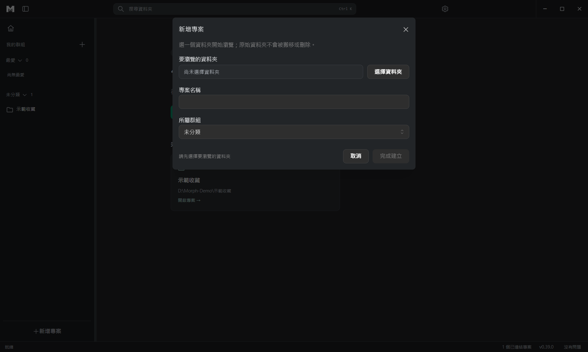
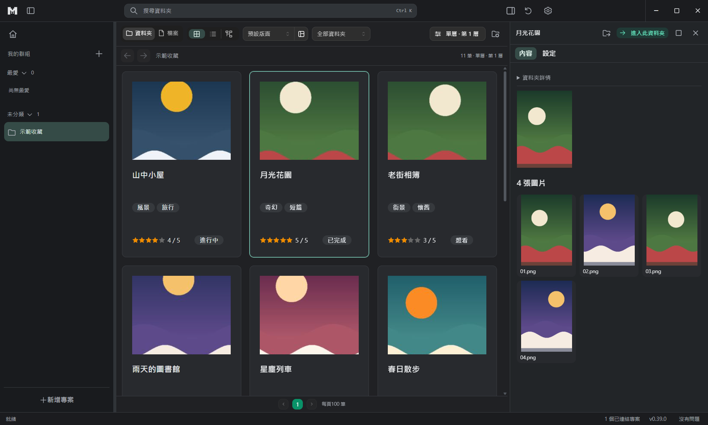
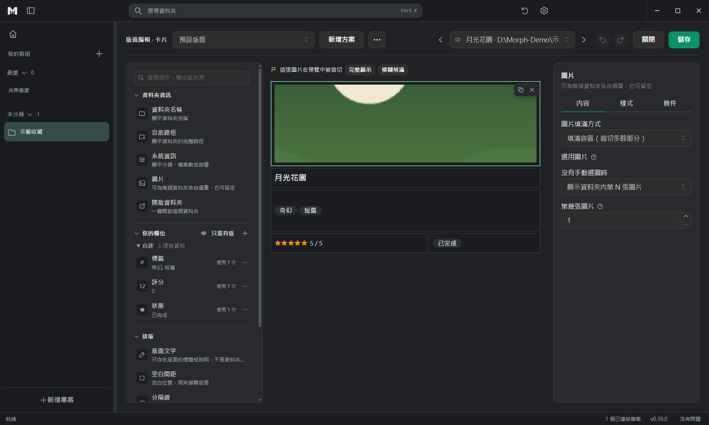

# M:orph user guide

English · [繁體中文](USER_GUIDE.zh-TW.md)

This guide is for people who **use** M:orph. The labels below are the ones on screen; the interface comes in five languages, and the names here are the English ones (the Traditional Chinese guide gives the original labels). For design and specifications see the [documentation index](README.md).

## 1. Install and start

There are two ways to run M:orph (take them from the project's releases, or from `release/morph <version>/` after building it yourself):

- **Portable** `Morph-Portable-<version>.exe`: double-click and it runs, good for trying it out. The first start is a little slow.
- **Installer** `Morph-Setup-<version>.exe`: lets you choose the folder, installs for the current user only and needs no administrator rights. Uninstall from "Settings → Apps".

The current builds are **not code-signed**, so on the first run Windows shows a blue SmartScreen warning: click **More info**, then **Run anyway**.

Your settings and the search index live in `%APPDATA%\media-viewer`; each managed folder keeps its own record in a hidden `.media-viewer` folder inside it. **M:orph only views your data: it never moves, renames or deletes your original files just for browsing.**

## 2. Basic ideas

- **Project**: points at one **root folder** and decides how the folders below it are shown. A project has the depth it shows; each folder works out its own type (manga, album, game and so on).
- **Record**: every managed folder stores its own information (name, tags, rating, where it came from) with the folder, so it stays valid when the folder moves to another place or computer.
- **Layout**: the card look you design once in the block editor and apply to the whole project. Data and appearance are separate.

## 3. Create your first project

1. Press **New project** at the bottom of the left project bar.
2. Press **Choose folder** to pick the root folder. The project name starts as the folder name and can be changed; then pick a group.
3. Press **Create project**. M:orph scans the folder and creates the folder info, and the project appears in the list.
4. Use **Add group** to group projects; a project can also be marked as a favourite.

If the folder already holds an earlier project (a new computer, a moved folder, or a project you removed from the list), choosing it offers **Bring back the project**, which keeps its settings and info. To bring info back from a backup, use "Restore from backup" in application settings › Backup.

## 4. Browse

- The top bar offers three modes over the same data: **CARD**, **TABLE** and **TREE**.
- A **single click** on a folder previews it in the right panel (details, files, subfolders) without leaving the list; a **double click** enters it.
- The right panel opens images, manga, video, music and PDF / ZIP / CBZ in place. When a video cannot be played, the app explains why and offers to open it with the system player.
- Filters, file scope, type and view settings are remembered per project.
- When the window is narrow, the right panel opens over the list; close it to get back to the cards.
- `Ctrl+K` opens search: a space means "all of these", `~` means "any of these", `-` excludes, and quotes keep a phrase with spaces together, for example `folder_name:"my name"`. Number and date fields can be compared.

## 5. Design the card (block editor)

1. Press **Edit layout** in the toolbar.
2. Drag **components** from the left onto the canvas: name, path, text, tags, number, rating, date, choice, link, image, divider; game projects also have **Game cover** and **Launch game**. Create a new field with "+ New field"; fields already imported are under "Reference existing folder fields".
3. Select a component and adjust it on the right: **Content** (which field it shows), **Visibility condition**, **Position and size**, **Style** (size, weight, colours, border, corners, presets, colour tags by category…).
4. **Fallback fields**: one component can list several fields and shows the first one that has a value, for example "Steam name → DLsite name → my own note". Search follows the same order.
5. "Preview with actual data" at the top lets you pick a real folder and see the components filled with its data. When content is long, choose scrolling, wrapping, or the tag "+N" badge.
6. Press **Save changes**, or **Cancel** to drop them. A project can have several named layouts.

## 6. Add information to a folder

Open a folder's **Folder settings**. The "Still to add" card at the top lists what this folder lacks (launch file, cover, work data); its buttons take you straight to the right place:

- **Data**: fill in this folder's fields; the "Info shared by all projects / Current project only" switch at the top right says which projects a change affects. While something is unsaved, a Save / Discard bar stays at the bottom and the tab shows a dot.
- **Import from source** (at the top of the Data tab): paste the address of the work and the source is recognised from it (E-Hentai / ExHentai, Steam, DLsite, VNDB, Bangumi, AniList, Hitomi, Pixiv, MusicBrainz, Open Library, Wikimedia Commons; for Steam the App ID works too). **Get preview** is enabled only for a known site, and you choose which fields to import afterwards. Nothing is fetched unless you ask. Some sources carry adult content; using them is up to you.
- **Image**: click the thumbnail to pick a saved image, import a new one or clear it; a component can also show "the Nth image of the folder" when none is picked.

## 7. Games

- Game folders are detected and protected: M:orph never creates records inside a game. If one is missed, mark it as the game's main folder by hand.
- In Folder settings → **Game actions**, bind actions to this game: an EXE (with arguments), a folder, a file, a web address, or a **shortcut** inside the game folder (for example a Locale Emulator `.lnk`, which keeps its own settings). Use "Customize toolbar" to add actions, and the play icon next to an action to test-launch it.
- Only bound actions appear in the button row, and the eye icon next to each action hides it for this game. A "Launch game" component can list fallback actions and starts whichever one this game has.

## 8. Appearance, language and backup

The gear at the top right opens **Application settings**:

- **Appearance**: three themes (Classic dark, Frosted glass, Paper and ink) and five languages, previewed before you save.
- **Backup** (application settings › Backup): "Create backup" saves your settings and the info of every project (tags, ratings, covers, subtitles) as one folder; your files are not copied. "Restore from backup" first lists what is inside so you can tick what to restore; if a folder has moved, press "Choose new location". Your current settings are saved before restoring settings, and "Go back to earlier settings" undoes it.
- **Remove a project** (project settings › Remove): "Remove from list" only takes the project off the list; all its info stays and you can add it back later. "Delete this project's info…" deletes only this project's own info by default; to also delete shared info, game decisions and projects removed from the list earlier, tick "Also delete the other info M:orph created in these folders" (a backup is made first). Your files (manga, images, videos) are never deleted.

## 9. FAQ

**Windows says unknown publisher / SmartScreen blocks it?** There is no signature yet, see section 1.

**Will it touch my files?** It never moves, renames or deletes original files. M:orph only adds its own `.media-viewer` record to managed folders, and the clean-up function removes only what it created, after a preview.

**I moved a folder. Is the record still there?** Yes. The record travels with the folder; relink the project at the new location.

**A video does not play?** Usually the file itself is damaged (for example an archive renamed to `.mp4`) or uses a codec the browser engine does not support. The message on screen says which, and you can open it with the system player.

**How do I report a problem or a vulnerability?** Open an issue for ordinary problems; for security problems follow [SECURITY](../SECURITY.md) and report privately.
