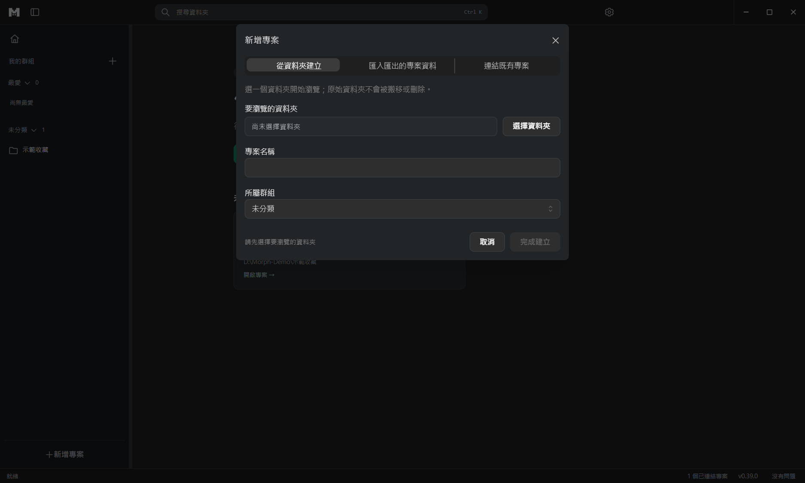
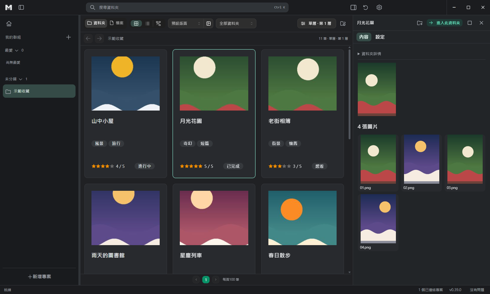
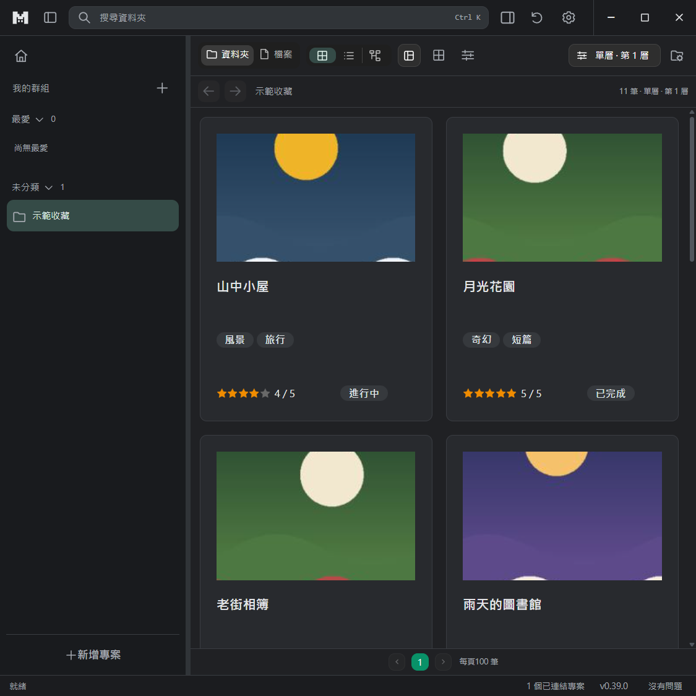
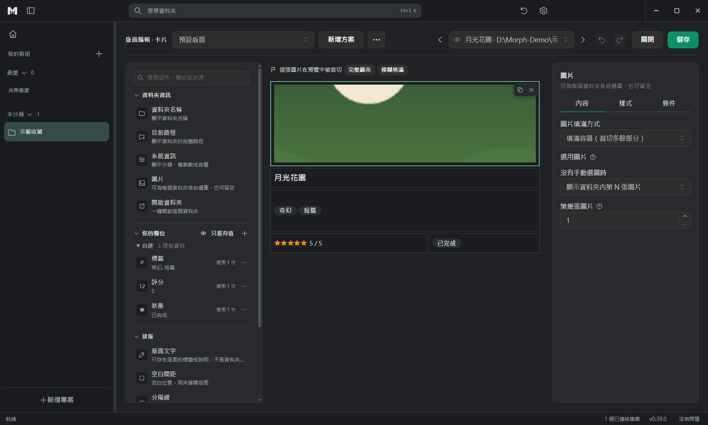

# M:orph 使用指南

[English](USER_GUIDE.md) · 繁體中文

這份指南給「用」M:orph 的人。畫面上的文字以實際介面為準；介面有五種語言，這裡用繁體中文的名稱。想了解設計與規格請看 [文件索引](README.md)。

## 1. 安裝與啟動

M:orph 有兩種執行檔（從專案的發行檔或自行建置的 `release/morph <版本>/` 取得）：

- **免安裝版** `Morph-Portable-<版本>.exe`：雙擊就能執行，適合先試用。第一次啟動會稍慢。
- **安裝程式** `Morph-Setup-<版本>.exe`：可選安裝位置，只裝給目前使用者，不需要系統管理員權限；解除安裝在「設定 → 應用程式」。

目前的版本**沒有程式碼簽章**，第一次執行時 Windows 會出現藍色的 SmartScreen 警告：點「**其他資訊**」，再點「**仍要執行**」。

你的設定與搜尋索引放在 `%APPDATA%\media-viewer`；每個資料夾的記錄放在該資料夾自己的 `.media-viewer` 隱藏資料夾裡。**M:orph 只檢視你的資料，不會為了瀏覽而搬移、改名或刪除原始檔案。**

## 2. 基本概念

- **專案**：指向一個**根資料夾**，並決定怎麼顯示它底下的資料夾。一個專案有顯示的層級；每個資料夾會各自判斷類型（漫畫、相簿、遊戲等）。
- **記錄**：每個受管資料夾保存自己的資訊（名稱、標籤、評分、來源…），跟著資料夾走，搬到別處或別台電腦仍然有效。
- **版面**：用「積木編輯器」設計一次的卡片外觀，套用到整個專案。資料和外觀是分開的。

## 3. 建立第一個專案

1. 按左側專案欄下方的「**新增專案**」。
2. 按「**選擇資料夾**」指定根資料夾，專案名稱會先帶入資料夾名稱，可自行修改，再選所屬群組。
3. 按「**完成建立**」，它會掃描並建立資訊，專案出現在左側清單。
4. 可以用「新增群組」把專案分組，也能標為最愛。

資料夾裡已經有之前的專案（例如換了電腦、搬了位置，或曾「從清單移除」）時，選好資料夾後會出現「**接回原本的專案**」，原有的設定與資訊都會保留。要從備份帶回資訊，用應用程式設定 › 備份的「從備份還原」。

## 4. 瀏覽

- 頂部有三種模式：**卡片**、**表格**、**樹狀圖**，看的是同一份資料。
- **單擊**資料夾會在右側面板預覽（詳情、檔案、子資料夾），不離開目前的列表（面板收起時，滑過卡片的「顯示資料夾內容」圖示可打開）；**雙擊**才進入該資料夾。
- 右側面板能直接看圖片、漫畫、影片、音樂、PDF／ZIP／CBZ。影片播放不了時會說明原因，並提供用系統播放器開啟。
- 篩選、檔案範圍、類型、檢視方式會按專案記住。
- 視窗變窄時，右側面板會蓋在列表上，關掉它就回到卡片。

- `Ctrl+K` 開啟搜尋：空格代表「同時符合」，`~` 代表「任一符合」，`-` 代表排除，用引號包住含空格的詞，例如 `folder_name:"中文 名稱"`；欄位可以比較數字與日期。

## 5. 設計卡片（積木編輯器）

1. 在工具列按「**編輯版面**」。
2. 從左側素材面板點一下或拖到畫布：**資料夾資訊**（名稱、路徑、系統資訊、圖片、開啟資料夾）、**你的欄位**（依來源分組，含資料夾裡尚未加入的欄位）、**排版**（版面文字、空白間距、分隔線）；遊戲專案還有**遊戲**（遊戲封面、啟動遊戲）。「你的欄位」標題列的「只看有值」只顯示預覽資料夾有值的欄位。上方搜尋框找不到時，可直接「＋ 建立欄位」；尚未加入的欄位收在「＋ N 個尚未加入」；欄位的改名、刪除在每列的「⋯」；標題列的 ⚙ 打開「管理欄位」，照來源分組看全部欄位，點一個看它的用途、實際資料與用在哪裡。新增欄位時直接選它要記什麼（一段文字、多個標籤、從清單選一個…）；之後可在欄位詳細按「改成…」，不會改寫資料夾裡已存的值。
3. 點選組件，在右側三個分頁調整：**內容**（「顯示：…［更換］」選欄位或群組）、**樣式**（字級、粗細、顏色、邊框、圓角、預設樣式…；位置與大小在「進階」）、**條件**（何時顯示）。組件上方浮出複製／移除按鈕，也可用 Ctrl+D／Delete；點畫布空白處看整張卡片。
4. **欄位群組**：同一種資料來自不同網站時，把一個欄位拖到另一個欄位上（或「⋯ › 加入群組」、Ctrl＋點選多個後「組成群組」）就成了群組，例如「遊戲標題 = Steam 名稱 → DLsite 名稱 → Getchu タイトル」。卡片依順序顯示第一個有值的；點群組可打開來排順序、移出成員或「加到卡片」；個別資料夾可在資料夾設定指定要顯示哪一個。搜尋時寫群組名稱，任一成員符合就找得到。舊版的「備用欄位」組件照常顯示，可在內容分頁「轉成群組」。
5. 上方工具列的預覽選單可以選一個真實資料夾（或「各欄位最長／最短的資料」），兩側箭頭切換上一個／下一個，直接看組件塞了真資料的樣子；畫布上方一行會提示有沒有內容被截掉。內容太長時，可選「可捲動」、換行，或標籤的「+N」。
6. 按「儲存」；不想保留就「放棄變更」。每個專案可以有多個命名的版面。

## 6. 補充資料夾資訊

打開某個資料夾的「**資料夾設定**」。最上方的「還可以補上」會列出這個資料夾還缺的東西（啟動檔、封面、作品資料），按旁邊的按鈕就會直接到對應位置：

- **資料**：填寫這個資料夾的欄位；右上角可切換「各專案共用的資訊／僅目前專案」，下方會說明改動會影響哪些專案；有未保存的內容時，底部會出現固定的「保存／放棄」列，分頁標籤也會顯示小圓點。
- **從網站補充資訊**（在「資料」分頁最上方）：貼上作品網址，程式依網域自動辨識來源（支援 E-Hentai／ExHentai、Steam、DLsite、VNDB、Bangumi、AniList、Hitomi、Pixiv、MusicBrainz、Open Library、Wikimedia Commons；Steam 可直接輸入 App ID），辨識成功才能按「**取得預覽**」，確認後再選要匯入哪些欄位。你不要求就不會連網。部分來源含成人內容，要不要使用由你決定。
- **圖片**：點縮圖，從已保存的圖片選一張、匯入新圖片或清除；組件也能設成「沒有手動選圖時顯示第 N 張圖片」。

## 7. 遊戲

- 遊戲資料夾會被偵測並保護：M:orph 不會在遊戲內部建立資訊。偵測不到時，可手動標為遊戲主資料夾。
- 在資料夾設定的「**遊戲操作**」把動作綁到這個遊戲：EXE（可帶參數）、資料夾、檔案、網址，或資料夾內的**捷徑**（例如 Locale Emulator 做的 `.lnk`，會保留捷徑自己的設定）。用「自訂工具列」新增動作。
- 只有綁定過的動作才會出現在按鈕列；每個動作旁的眼睛圖示可以逐個遊戲隱藏。「啟動遊戲」組件可以列出備用動作，這個遊戲用哪個就啟動哪個。

## 8. 外觀、語言與備份

右上角的齒輪「**應用程式設定**」：

- **外觀**：三種主題（深色經典、霧白玻璃、暖紙墨橘）與五種語言，先預覽再保存。
- **備份**（應用程式設定 › 備份）：「建立備份」把設定和所有專案的資訊（標籤、評分、封面、字幕）存一份在這台電腦裡，你的檔案不會被複製。下方清單列出所有備份，每一筆可以「還原」「匯出…」（複製到其他磁碟或電腦）或「刪除」。還原前會先列出內容讓你勾選，資料夾搬了位置就按「選擇新位置」。還原專案只會補上缺少的資訊，已經有的不會被覆蓋；還原設定會取代目前的設定，還原後備份頁上方會出現「回到還原之前」，按下就回到原本的設定。在另一台電腦匯出的備份，用「從檔案還原…」。
- **移除專案**（專案設定 › 移除）：「從清單移除」只把專案從清單拿掉，資訊全部保留，之後可以加回來。「刪除這個專案的資訊…」預設只刪這個專案自己的資訊；要連共用的資訊、遊戲判斷和之前從清單移除的專案一起刪，要另外勾選「也刪除這些資料夾裡 M:orph 建立的其他資訊」，刪除前會先備份。你的檔案（漫畫、圖片、影片）不會被刪除。語言與主題在「一般」，選了就套用。

## 9. 常見問題

**Windows 說不明的發行者／SmartScreen 擋住？** 目前沒有簽章，見第 1 節。

**會不會動到我的檔案？** 不會搬移、改名或刪除原始檔。M:orph 只在受管資料夾裡新增自己的 `.media-viewer` 記錄；清理功能只移除它建立的東西，並會先讓你預覽。

**我把資料夾搬走了，記錄還在嗎？** 在。記錄跟著資料夾，到新位置重新連結專案即可。

**影片播不出來？** 通常是檔案本身有問題（例如被改了副檔名的壓縮檔）或編碼瀏覽器不支援；畫面上的說明會告訴你原因，並可用系統播放器開啟。

**怎麼回報問題或漏洞？** 一般問題在專案的 issue 回報；安全問題請依 [SECURITY](../SECURITY.md) 私下回報。
